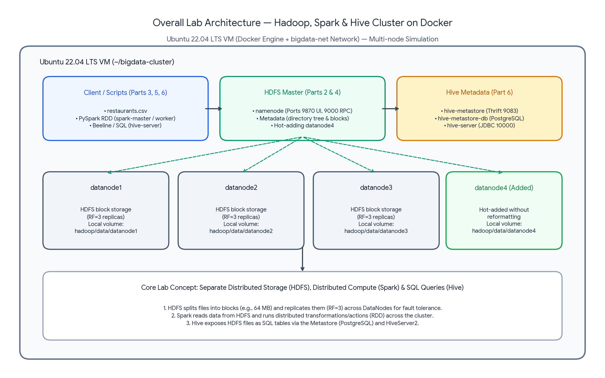

# Hadoop · Spark · Hive Cluster on Docker

A multi-node Big Data lab running entirely in Docker on a single Ubuntu 22.04 VM: **HDFS** for distributed storage, **Spark** for distributed compute, and **Hive** for SQL on top of HDFS.


> **Scope:** the "nodes" are containers on one machine. They simulate a multi-node architecture but are not a cluster spread over several physical hosts, and there is no high availability.



## What's inside

| Layer | Component | Version | Container(s) | Ports |
|---|---|---|---|---|
| Storage | HDFS NameNode | Hadoop 3.2.1 | `namenode` | 9870 (UI), 9000 (RPC) |
| Storage | HDFS DataNodes | Hadoop 3.2.1 | `datanode1` … `datanode4` | 9864 (internal) |
| Compute | Spark Standalone master | Spark 3.5.6 | `spark-master` | 8080 (UI), 7077 |
| Compute | Spark worker | Spark 3.5.6 | `spark-worker1` | internal |
| SQL | Hive Metastore | Hive 3.1.3 | `hive-metastore` | 9083 (Thrift, internal) |
| SQL | Metastore database | PostgreSQL 13 | `hive-postgres` | 5432 (internal) |
| SQL | HiveServer2 | Hive 3.1.3 | `hive-server` | 10000 (JDBC), 10002 (UI) |

All containers share one Docker network, `bigdata-net`. HDFS replication factor is 3.

## Repository layout

```
.
├── compose.yaml                  # all services
├── restaurants.csv               # sample dataset (8 restaurants)
├── hadoop/
│   └── config/                   # core-site.xml, hdfs-site.xml (mounted into Spark and Hive)
├── hive/
│   ├── hive-site-metastore.xml   # Metastore config (PostgreSQL connection)
│   └── hive-site-server.xml      # HiveServer2 config (Metastore URI, MapReduce local mode)
└── docs/
    └── architecture.png
```

Not versioned (see `.gitignore`): `hadoop/data/` (HDFS data), `hive/pgdata/` (PostgreSQL data), `hive/postgresql.jar` (downloaded below).

## Requirements

- Ubuntu 22.04 VM, 4 vCPU minimum (6 recommended)
- 8 GB RAM minimum (10 to 16 GB recommended), 50 GB free disk
- Docker Engine and the Docker Compose plugin

Tested with Docker 29.1.3 and Compose 2.40.3.

## Quick start

```bash
git clone https://github.com/StormShadoX/bigdata-cluster.git
cd bigdata-cluster

# Data folders and the PostgreSQL JDBC driver (not stored in the repo)
mkdir -p hadoop/data/{namenode,datanode1,datanode2,datanode3,datanode4} hive/pgdata hive/notez
curl -L -o hive/postgresql.jar \
  https://repo1.maven.org/maven2/org/postgresql/postgresql/42.7.3/postgresql-42.7.3.jar
```

### 1. HDFS

Start the NameNode first, give it a minute, then the DataNodes:

```bash
docker compose up -d namenode
sleep 60
docker compose up -d datanode1 datanode2 datanode3 datanode4
sleep 30
docker exec namenode hdfs dfsadmin -report | grep -E "Live datanodes|Dead datanodes"
```

Expected: `Live datanodes (4)`. A container showing `Up` is not enough, the HDFS report is the proof that DataNodes registered.

Load the sample data and prepare Hive's directories:

```bash
docker cp restaurants.csv namenode:/tmp/restaurants.csv
docker exec namenode hdfs dfs -mkdir -p /user/iset/data /user/iset/output /user/hive/warehouse /tmp/hive
docker exec namenode hdfs dfs -put -f /tmp/restaurants.csv /user/iset/data/
docker exec namenode hdfs dfs -chmod -R 777 /user/iset/output /user/hive /tmp/hive
```

> `chmod 777` is acceptable only in this isolated lab.

### 2. Spark

```bash
docker compose up -d spark-master spark-worker1
```

Open http://localhost:8080 and check that the worker is `ALIVE`.

### 3. Hive

**First start only:** the Metastore schema must be created once. In `compose.yaml`, temporarily comment out the line `IS_RESUME: "true"` in the `hive-metastore` service, then:

```bash
docker compose up -d hive-postgres
sleep 20
docker compose up -d hive-metastore
docker logs --tail=20 hive-metastore     # wait for "Initialized schema successfully" and "Starting Hive Metastore Server"
```

Restore the `IS_RESUME: "true"` line, then run `docker compose up -d hive-metastore hive-server`. On later starts, `IS_RESUME` stays on so the Metastore does not try to re-create an existing schema.

HiveServer2 takes one to two minutes to open port 10000:

```bash
until docker exec hive-server bash -c 'timeout 3 bash -c "</dev/tcp/localhost/10000"' 2>/dev/null; do echo waiting...; sleep 10; done
docker exec -it hive-server beeline -u 'jdbc:hive2://localhost:10000/default' -n hive
```

> This clean-clone sequence is documented from the lab's working setup; the Hive part in particular depends on exact image versions, so check container logs if a step differs.

## Try it

### HDFS: blocks and replicas

```bash
docker exec namenode bash -c '
  yes "Restaurant,Nabeul,Tunisien,25" | head -c 300000000 > /tmp/restaurants_big.csv
  hdfs dfs -mkdir -p /user/iset/blocs
  hdfs dfs -D dfs.blocksize=67108864 -put /tmp/restaurants_big.csv /user/iset/blocs/
  hdfs fsck /user/iset/blocs/restaurants_big.csv -files -blocks -locations'
```

A 300 MB file with 64 MiB blocks gives 5 blocks, each with 3 replicas spread over the DataNodes. The big file goes in `/user/iset/blocs`, not `/user/iset/data`, because the Hive external table reads everything in `/user/iset/data`.

### Spark: RDD aggregation

```bash
docker exec -it spark-worker1 /opt/spark/bin/pyspark --master spark://spark-master:7077
```

```python
lignes = sc.textFile("hdfs://namenode:9000/user/iset/data/restaurants.csv")
data = lignes.filter(lambda l: not l.startswith("id,"))
vp = data.map(lambda l: (l.split(",")[2], float(l.split(",")[4])))
nb = vp.mapValues(lambda p: 1).reduceByKey(lambda a, b: a + b)
somme = vp.reduceByKey(lambda a, b: a + b)
somme.join(nb).mapValues(lambda x: (x[1], round(x[0] / x[1], 2))).collect()
```

### Hive: SQL on the same file

```sql
CREATE DATABASE iset_bigdata;
USE iset_bigdata;

CREATE EXTERNAL TABLE restaurants (
  id INT, restaurant STRING, ville STRING, type STRING, prix FLOAT)
ROW FORMAT DELIMITED FIELDS TERMINATED BY ','
STORED AS TEXTFILE
LOCATION '/user/iset/data'
TBLPROPERTIES ("skip.header.line.count"="1");

SELECT ville, COUNT(*) AS nombre, ROUND(AVG(prix), 2) AS prix_moyen
FROM restaurants GROUP BY ville;
```

### Spark vs Hive: same answers

| City | Restaurants | Average price |
|---|---|---|
| Nabeul | 2 | 30.0 |
| Tunis | 2 | 34.0 |
| Hammamet | 2 | 26.0 |
| Sousse | 2 | 25.0 |

Both engines return identical results. Most represented type: Tunisien and Italien tie at 3 restaurants each, FastFood has 2.

Hive aggregations run as a **local** MapReduce job (about 5 s each); there is no YARN in this lab.

## Hot-adding a DataNode

`datanode4` was added to a running cluster with no NameNode reformat and no restart of the other nodes:

```bash
mkdir -p hadoop/data/datanode4
# add the datanode4 service to compose.yaml, then:
docker compose up -d datanode4
docker exec namenode hdfs dfsadmin -report | grep "Live datanodes"
```

Capacity goes up immediately, but existing blocks are not rebalanced onto the new node (that would need `hdfs balancer`). Only new files use it.

## Managing the lab

| Task | Command |
|---|---|
| Status | `docker compose ps` |
| Logs of one service | `docker logs --tail=100 namenode` |
| Stop everything (data kept) | `docker compose stop` |
| Start again | `docker compose start` |
| Remove containers and network | `docker compose down` |

**Never** run `hdfs namenode -format` or delete `hadoop/data/` to fix a container problem. `docker compose down` keeps your data; deleting the data folders does not.

Shut the VM down cleanly (`docker compose stop`, then `poweroff`) instead of suspending it.

## Troubleshooting

Problems met while building this lab, and their fixes.

| Symptom | Cause | Fix |
|---|---|---|
| `could only be written to 0 of the 1 minReplication nodes`, `Dead datanodes (3)` | VM was suspended, DataNodes lost their heartbeat | `docker compose restart datanode1 datanode2 datanode3` |
| Hive Metastore: `authentication type 10 is not supported` | PostgreSQL 14+ uses SCRAM-SHA-256, the Hive 3.1.3 JDBC driver does not | Use `postgres:13`, empty `hive/pgdata` once |
| HiveServer2: `URISyntaxException ... bigdata-cluster_bigdata-net` | Underscore in the default Compose network name is rejected by Java | Name the network explicitly: `name: bigdata-net` |
| Metastore: `relation "BUCKETING_COLS" already exists` | Start script re-ran `initSchema` on an existing schema | `IS_RESUME: "true"` on `hive-metastore` after the first start |
| `get_current_notificationEventId ... not allowed to perform this API call` | Metastore authorization check on the `hive` user | `hive.metastore.event.db.notification.api.auth=false` in `hive-site-metastore.xml` (lab only) |
| `NoClassDefFoundError: org/apache/hadoop/metrics/Updater` on `GROUP BY` | MapReduce 2.7 jars from `/opt/tez` mixed with Hadoop 3 | Mount an empty folder over `/opt/tez` in `hive-server` |
| Spark: `UnknownHostException: namenode` | Spark containers stayed on the old network after the rename | `docker compose up -d --force-recreate spark-master spark-worker1` |
| PySpark: `no attribute 'startwith'` | Typo | `startswith` |

## Security notes

This is a teaching lab, not a production setup. Passwords in `compose.yaml` and the Hive XML files (`hivepass`) are throwaway values, HDFS directories are opened with `777`, and no service is authenticated. Do not expose these ports outside the VM.

## References

- [HDFS architecture](https://hadoop.apache.org/docs/stable/hadoop-project-dist/hadoop-hdfs/HdfsDesign.html)
- [Spark RDD programming guide](https://spark.apache.org/docs/3.5.6/rdd-programming-guide.html)
- [Spark Standalone mode](https://spark.apache.org/docs/3.5.6/spark-standalone.html)
- [Apache Hive](https://hive.apache.org/)
- [Docker Compose](https://docs.docker.com/compose/)
